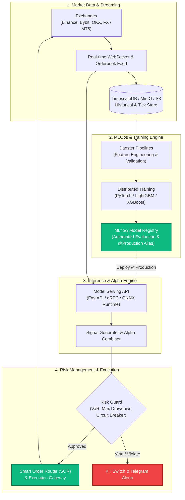

<div align="center">

# ⚡ MLTradeBot

### Autonomous, ML-Driven Quantitative Trading & MLOps Platform
**High-Frequency Signal Generation • Production MLOps • Institutional Risk Management**

<p align="center">
  <a href="https://github.com/mltradebot"></a>
  <a href="https://python.org"></a>
  <a href="https://dagster.io"></a>
  <a href="https://mlflow.org"></a>
  <a href="https://kubernetes.io"></a>
  <a href="https://opensource.org/licenses/MIT"></a>
</p>

<p align="center">
  <a href="#-overview">Overview</a> •
  <a href="#-core-pillars">Core Pillars</a> •
  <a href="#-system-architecture">System Architecture</a> •
  <a href="#-organization-ecosystem">Ecosystem</a> •
  <a href="#-tech-stack">Tech Stack</a> •
  <a href="#-getting-started">Getting Started</a> •
  <a href="#-risk-disclaimer">Disclaimer</a>
</p>

---

</div>

## 📌 Overview

**MLTradeBot** is an open-source, modular quantitative trading platform designed to bridge cutting-edge Machine Learning and low-latency algorithmic trade execution across **Cryptocurrency** (Binance, Bybit, OKX) and **Foreign Exchange (FX)** markets.

Unlike traditional static rule-based bots, **MLTradeBot** operates on an autonomous **MLOps feedback loop**: market microstructure and orderbook telemetry are streamed in real time, fed into continuous feature engineering pipelines, retrained and versioned through **Dagster** & **MLflow**, and deployed to low-latency inference services with multi-layer risk controls.

---

## 🏛️ Core Pillars

<table>
  <tr>
    <td width="33%" align="center">
      <h3>🔄 MLOps Continuous Loop</h3>
      <p align="left">Automated asset-level data ingestion, feature stores, scheduled retraining with Dagster, and automated promotion of top-performing models using MLflow <code>@Production</code> aliases.</p>
    </td>
    <td width="33%" align="center">
      <h3>⚡ Low-Latency Execution</h3>
      <p align="left">Async event-driven execution core capable of real-time WebSocket orderbook ingestion, microsecond signal routing, smart order slicing, and slippage minimization.</p>
    </td>
    <td width="33%" align="center">
      <h3>🛡️ Institutional Risk Guard</h3>
      <p align="left">Real-time Value at Risk (VaR), dynamic volatility-adjusted position sizing (Kelly & ATR), circuit breakers, max drawdown gates, and instantaneous hard stop-loss execution.</p>
    </td>
  </tr>
</table>

---

## 🏗️ System Architecture



---

## 🌐 Organization Ecosystem

The `mltradebot` ecosystem is organized into specialized, decoupled repositories:

| Repository | Description | Status |
| :--- | :--- | :---: |
| [**`.github`**](https://github.com/mltradebot/.github) | Organization profile, community standards, global CI/CD actions & issue templates | 🟢 Active |
| [**`core-engine`**](https://github.com/mltradebot/core-engine) | Asynchronous execution engine, order router, exchange connectors & order state machine | 🟡 In Dev |
| [**`ml-pipelines`**](https://github.com/mltradebot/ml-pipelines) | Dagster user code location, feature engineering, and automated training workflows | 🟢 Active |
| [**`model-serving`**](https://github.com/mltradebot/model-serving) | High-performance inference API serving production models with drift detection | 🟢 Active |
| [**`backtest-lab`**](https://github.com/mltradebot/backtest-lab) | Event-driven backtesting engine with realistic latency, orderbook depth & fee modeling | 🟡 In Dev |
| [**`risk-guard`**](https://github.com/mltradebot/risk-guard) | Capital allocation, VaR monitor, margin protection, and emergency kill-switch | 🟡 In Dev |
| [**`devops`**](https://github.com/mltradebot/devops) | Declarative GitOps infrastructure (Kubernetes, ArgoCD, Prometheus, Grafana, Traefik) | 🟢 Active |

---

## 💻 Tech Stack

```
Data & Features       Polars • Pandas • TimescaleDB • Redis • MinIO
ML & Analytics        PyTorch • LightGBM • Scikit-Learn • Optuna • Ray
MLOps & Workflow      Dagster • MLflow 3.x • DVC
Execution Engine      Python 3.12+ • Asyncio • WebSockets • CCXT • MetaTrader 5
Serving & Telemetry   FastAPI • gRPC • Prometheus • Grafana • OpenTelemetry
Infrastructure        Kubernetes (k3s) • Docker • Argo CD • Traefik • OCI Cloud
```

---

## 🚀 Quickstart & Local Setup

### 1. Prerequisites
- **Python**: `3.12+`
- **Package Manager**: [`uv`](https://github.com/astral-sh/uv) *(recommended)* or `poetry`
- **Container Runtime**: Docker & Docker Compose

### 2. Clone the Repositories
```bash
# Clone the core engine & pipelines
git clone https://github.com/mltradebot/core-engine.git
git clone https://github.com/mltradebot/ml-pipelines.git
git clone https://github.com/mltradebot/model-serving.git
```

### 3. Start Local MLOps & Serving Stack
```bash
# Start MLflow, Dagster, and Model Serving
cd model-serving
docker compose up -d
```

### 4. Validate Dagster Pipelines
```bash
cd ../ml-pipelines
uv sync
uv run dagster definitions validate -m ml_pipelines.definitions
```

---

## 📈 Roadmap

- [x] Initial MLOps Platform setup (Dagster + MLflow + Kubernetes GitOps)
- [x] Production Model Serving API with Prometheus telemetry
- [ ] High-frequency WebSocket streaming connector for Binance & Bybit
- [ ] Automated Alpha Factor backtesting with realistic slippage simulation
- [ ] Reinforcement Learning (PPO/SAC) execution agent for dynamic order sizing
- [ ] Distributed multi-exchange arbitrage & hedging module

---

## ⚠️ Financial & Risk Disclaimer

> [!CAUTION]
> **NOT FINANCIAL ADVICE.**
>
> Algorithmic trading and quantitative investment in cryptocurrencies and foreign exchange involve **substantial risk of financial loss**. Past performance of backtests and machine learning models does not guarantee future results.
>
> This software is distributed under the MIT License for educational and research purposes. You are solely responsible for all financial decisions, live capital allocations, and exchange API credentials. Never trade with money you cannot afford to lose.

---

## 🤝 Contributing & Community

We welcome contributions from quantitative analysts, ML engineers, and algorithmic traders!

- 🐛 **Found a bug?** Submit an [Issue](https://github.com/mltradebot/.github/issues).
- 💡 **Have a strategy or feature idea?** Start a discussion on [GitHub Discussions](https://github.com/mltradebot/.github/discussions).
- 📜 **Contribution Guidelines:** Please read our [Contributing Guide](https://github.com/mltradebot/.github/blob/main/CONTRIBUTING.md) and adhere to our Code of Conduct.

<div align="center">
  <sub>Built with precision by the <b>MLTradeBot</b> Quantitative Engineering Team.</sub>
</div>
